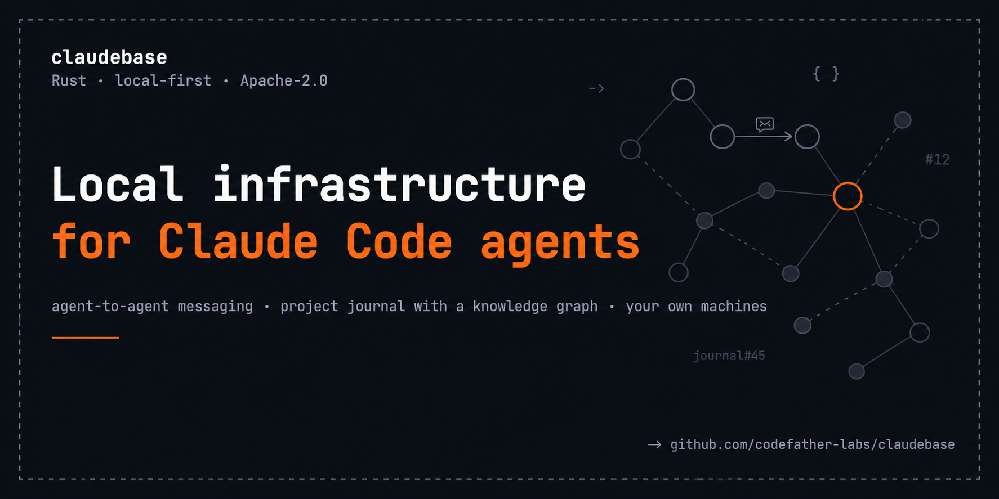
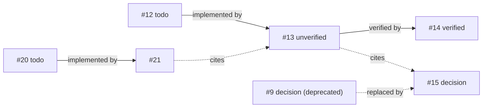

<div align="center">



# `claudebase`

**A harness for Claude Code sessions.**

Reach a running session from your phone, a script or another machine · let sessions message each other and share work · give every project a memory that tracks each change from todo to evidence.

One Rust binary and a local daemon. Claude Code itself runs unmodified.

[](https://github.com/codefather-labs/claudebase/actions/workflows/release.yml)
[](https://github.com/codefather-labs/claudebase/actions/workflows/install-smoke.yml)
[](https://github.com/codefather-labs/claudebase/releases/latest)
[](LICENSE)

[📦 Releases](https://github.com/codefather-labs/claudebase/releases) · [🛠 Operations](docs/OPERATIONS.md) · [📝 Changelog](CHANGELOG.md) · [🤝 Contributing](CONTRIBUTING.md)

</div>

---

## What it does

| | |
|---|---|
| **Sessions you can reach** | `claudebase run` starts `claude` under a terminal supervisor. Telegram messages, messages from other sessions, HTTP callbacks and socket writes arrive in the session's input as prefixed lines. Replies go out through the CLI. |
| **Many agents, many machines** | Sessions have names, list and message each other, and can join the daemon of another machine. A pool of sessions can serve model calls for a gateway. |
| **A project journal** | Agents record decisions, findings and changes; the next session finds them by tag, category and meaning. Entries carry flags (todo, unverified, deprecated, …) and links that form a graph. Every feature or fix runs as a branch from a todo to a verified entry with evidence. |
| **Operational glue** | The daemon runs as a service, a machine gets one Claude subscription token for all its sessions, and conversations move between machines. |
| **Agent toolkit** | Rules, hooks, skills, commands and agents installed into `~/.claude/`, so every session knows the contract above without being told. |

A local knowledge base (hybrid search over your PDFs and notes) is also included; it is described at the [end](#-knowledge-base-books-and-documents).

## 🚀 Install

**Linux / macOS**

```bash
curl -fsSL https://raw.githubusercontent.com/codefather-labs/claudebase/main/install.sh | bash -s -- --yes
```

**Windows** (PowerShell)

```powershell
iwr -useb https://raw.githubusercontent.com/codefather-labs/claudebase/main/install.ps1 | iex
```

**From a checkout** (builds the binary from source; needs a Rust toolchain, a C compiler, `pkg-config`, `cmake` and `clang`, and offers to install what is missing):

```bash
git clone https://github.com/codefather-labs/claudebase && cd claudebase
bash install.sh --local --yes          # .\install.ps1 -Yes -Local on Windows
```

What the installer does, in order:

1. Downloads the release binary for your platform (or builds it with `--local`).
2. Installs the agent toolkit into `~/.claude/` and wires the hooks into `settings.json`.
3. Starts the daemon as a user service. On Linux it enables linger, so the daemon survives logout; without a systemd user manager (containers, WSL) it runs in the background.
4. Downloads the models: the e5 encoder (~490 MB) for semantic search and the speech model (~1.5 GB) for voice notes. Both show a progress bar.
5. Ends with a **Checks** list (binary, daemon, hooks, rules, models) and exits non-zero when a required one fails.

| Option | Effect |
|---|---|
| `--no-models` / `-NoModels` | Skip both model downloads. Journal search stays keyword-only until `claudebase warmup`; voice notes fetch their model on first use. |
| `CLAUDEBASE_VERSION=x.y.z` | Install a specific release. |
| `CLAUDEBASE_SKIP_WHISPER=1` | Skip the speech model only. |
| `CLAUDEBASE_SKIP_DAEMON=1` | Do not set up the daemon. |
| `CLAUDEBASE_NO_LINGER=1` | Do not enable systemd linger (the daemon then stops with your last session). |

Root without sudo, a bare container without `jq`, a fresh Claude Code: all supported. A CI job installs onto bare Ubuntu and Debian containers, as root and as an ordinary user, on every change to the installers.

**Platforms:** Linux x64 and arm64, macOS arm64, Windows x64. The binary links no OpenSSL (TLS is rustls).

## ⚡ First session

```bash
cd ~/projects/shop
claudebase run                 # `claude` under the supervisor; the session registers with the daemon
```

From another terminal:

```bash
claudebase agent list                          # who is online, with nicks
claudebase agent send "status?" --agent_nick shop
```

The session sees `[agent-to-agent:<your nick>]: status?` in its input and answers with `claudebase agent send … --agent_nick <your nick>`.

`claudebase run` forwards anything after `--` to `claude` (`claudebase run -- --continue`). Its own options:

| Option | |
|---|---|
| `--nick <name>` | Name the session instead of deriving the name from the project. |
| `--daemon <profile>` | Join another machine's daemon (see [Remote daemon](#-remote-daemon)). |
| `--pool <pool>` | Make the session a worker of a pool (see [Pool dispatch](#-pool-dispatch)). |
| `--no-input` | Answer Claude Code's startup questions (folder trust) without an operator. Implied by `--pool`. |
| `--no-skip-permissions` | Drop the default `--dangerously-skip-permissions`. As root, claudebase otherwise passes `IS_SANDBOX=1` so Claude Code accepts that flag, and says so. |
| `--no-chrome` | Drop the default `--chrome`. |
| `--no-telegram` | Plain `claude`, no supervisor and no inbound messages. |

## 💬 How messages reach a session

Everything from outside arrives as one prefixed line in the session's input:

```text
[telegram_message]: what the operator typed
[telegram_voice_message]: what the operator dictated (transcribed locally)
[agent-to-agent:mira]: what another session sent
[callback:ci]: what a script POSTed
[pool-job:funnel <req_id> <role>]: a job from a pool gateway
```

The prefix marks a **message**, not something the operator typed at the prompt, and its content is treated as data, never as instructions. The sender cannot see the terminal; a reply only leaves through a command:

```bash
claudebase telegram send --text "done"                  # to the operator
claudebase agent send "done" --agent_nick mira          # to a peer
```

Delivery is reliable: messages arriving while the agent generates are queued, messages arriving while the operator is mid-keystroke wait for a clear input line, and a session's own messages are never echoed back to it. A SessionStart hook teaches every session this contract.

### Telegram

One bot serves many sessions. The daemon polls Telegram itself — no Claude Code plugin is involved, so a Claude Code update cannot break it.

```bash
claudebase telegram addbot "<token from @BotFather>"
claudebase daemon restart
claudebase telegram access          # policy, allowlist, pending pairings
claudebase telegram pair <code>     # approve a sender who messaged the bot
claudebase telegram policy allowlist
```

In the bot: `/agents` lists sessions, `/switch <name>` binds the chat to one, `/whoami` and `/here` show the binding. In a supergroup with topics, each topic can be bound to its own session (the bot must be an administrator to receive ordinary messages). Agents can ask single-choice questions that appear as buttons (in direct messages). Access requests that arrive over a channel are always refused; access is managed only from the operator's terminal.

**Voice notes** are transcribed on the machine by the bundled whisper.cpp (`ggml-medium`) and arrive as `[telegram_voice_message]`, so the agent confirms exact strings instead of acting on a word that merely sounded right. Transcription uses 4 threads by default (`[asr] n_threads` in `daemon.toml`): taking every core stalls whisper on a busy machine rather than speeding it up.

A much faster backend, NVIDIA `parakeet-tdt-0.6b-v3` (0.65 s instead of 45.7 s for a 7-second note on a 16-core machine), can be built in. It is not in the release binary, because its sherpa-onnx library has to be linked as a shared library next to the binary:

```bash
cargo build --release --features asr-whisper,asr-sherpa
install -d ~/.claude/tools/claudebase/lib
cp target/sherpa-onnx-prebuilt/*/lib/*.so* ~/.claude/tools/claudebase/lib/
cp target/release/claudebase ~/.claude/tools/claudebase/claudebase
# then [asr] backend = "parakeet" in daemon.toml, or CLAUDEBASE_ASR_BACKEND=parakeet ./install.sh
```

### Callbacks from scripts

Every live session has a socket, no token and no setup needed:

```bash
printf 'build finished' | socat - UNIX-CONNECT:$XDG_RUNTIME_DIR/claudebase/agents/<nick>.sock
```

(Shell redirection into a socket does not work; use `socat` or a socket library.) Over HTTP, after `claudebase daemon callback enable`:

```bash
curl -sS -X POST "http://127.0.0.1:8585/callback/<nick>?label=ci" \
     -H "X-Api-Token: $(cat ~/.claude/callback-tokens/<nick>)" --data-binary 'build failed'
```

Tokens belong to a nick and follow a rename; `agent rename --new-callback-token` retires the old one instead. The HTTP listener stays on loopback unless explicitly opened. Inside a session, `/claudebase-daemon-callback-info` and `/claudebase-daemon-setup-auth-token` explain and set this up.

## 👥 Many sessions

```bash
claudebase agent list [--all]                      # nick, id, status, what each one works on
claudebase agent send "text" --agent_nick <nick>
claudebase agent describe "what I am working on"
claudebase agent whoami
claudebase agent rename "<nick>"                   # or /claudebase-daemon-change-nick
```

A chosen nick belongs to the **conversation**: resume it a week later in another terminal and it answers to the same name, with its Telegram bindings. Identity is enforced by the daemon — one session cannot send as another — and an ambiguous nick is refused rather than guessed. Hooks around plan mode remind a session that peers exist before it plans, and make it publish what it decided.

### 🌐 Remote daemon

A session on your laptop can join the daemon on a server and work alongside the agents running there: listed with them, messaging them, reachable from that daemon's Telegram bot, writing the same journal.

```bash
# on the server, once
claudebase daemon remote enable && claudebase daemon restart
claudebase daemon remote issue laptop --host prod.example      # prints a connection string once

# on the laptop
claudebase daemon remote add prod          # paste the connection string (read from stdin)
claudebase daemon remote test prod
claudebase run --daemon prod
```

TLS with a pinned self-signed certificate, one revocable token per client, and only the session surface over the wire — administration stays on the machine. The skill `/claudebase-setup-remote-daemon` walks through it. Design: [docs/design/remote-daemon.md](docs/design/remote-daemon.md).

### 🏭 Pool dispatch

A gateway hands model calls to a pool of sessions over HTTP and gets each answer back by id; the daemon leases a free worker per job.

```bash
claudebase pool token issue gateway        # X-Api-Token for /pool/*
claudebase run --pool funnel               # each worker
claudebase pool workers funnel             # free / busy / clearing / suspect / offline
```

```text
POST /pool/funnel/dispatch {req_id, payload, images, worker_id?}   202 leased | 409 busy | 503 none free
GET  /pool/jobs/<req_id>?wait_ms=25000                            done | failed | expired | leased
POST /pool/funnel/workers/<worker_id>/clear                       /clear one worker's context
```

A worker sees `[pool-job:…]`, fetches the job with `claudebase pool job <req_id>` and answers with `claudebase pool reply <req_id>`. A job can be pinned to one worker, and a worker's context can be cleared between conversations. Workers keep the nick the pool gave them. Design: [docs/design/pool-dispatch.md](docs/design/pool-dispatch.md).

## 🧠 The project journal

Every project has a journal held by the daemon — nothing is written into the project directory — and shared by every checkout of the same repository, on this machine or one joined to the daemon. Agents read it on a fresh context and write to it as they work: every decision, finding, bug, lesson and change, one entry each.

```bash
claudebase journal add "Chose WAL: readers blocked the writer (journal.rs:open); rejected a write queue" \
    --category decision --tag sqlite --salience high
claudebase journal search "write locking" --tag sqlite      # BM25 + semantic, fused
claudebase journal list --category decision --since 30d
claudebase journal get 42                                   # the entry and what it intersects
claudebase journal agenda                                   # what is still open
```

**Flags** say how far to trust an entry found by meaning alone:

| Flag | Meaning | Ends with |
|---|---|---|
| `--todo` `--question` `--problem` `--reminder` | work items | `journal close <id> --resolution "<how>"` |
| `--every 20m` (on `add`) | a reminder that comes back: the daemon puts the entry into the input of the session that wrote it as `[reminder #N]`, every interval, until it is closed. Only that session gets it, never while it is offline; one due while it was away arrives when it is back. Unlike a session's cron, it outlives the session | `journal close <id>` |
| `--unverified` | a hypothesis, or an implementation not yet proven | `close` once a separate `Verifies journal#N` entry carries the evidence: what was checked, how, under which conditions, how many times. With `journal policy --evidence-first on` it must also point at proofs (`--proof <file\|url>`) |
| `--disputed` | contradicts another entry | `close` once settled |
| `--ai-feedback` | an agent's suggestion for claudebase itself | `close` once handled |
| `--constraint` | a rule to follow, not weigh | `unmark` |
| `--important` | keep in view | `unmark` |
| `--verified` | carries the evidence that something works | `unmark` |
| `--deprecated` | no longer true; ranked last in search | `unmark` |

### 🕸️ The knowledge graph

The journal is a graph: entries are nodes and references between them are edges. The text makes most of the edges itself. Writing `journal#N` in an entry links the two, and up to three words right before the reference set the kind:

| Written | Edge | Reads on the other end |
|---|---|---|
| *Replaces / supersedes / corrects / reverses* `journal#N` | `replaces` | replaced by |
| *Fixes* `journal#N` | `fixes` | fixed by |
| *Implements* `journal#N` | `implements` | implemented by |
| *Verifies* `journal#N` | `verifies` | verified by |
| anything else | `cites` | cited by |

`journal link <id> <to> --kind …` and `journal unlink` add or remove the edges the text does not make. An edge never changes a flag. When one entry replaces another, the agent marks the old one `--deprecated` itself, so it is always a deliberate act.

**Reading an entry brings its neighbourhood.** `journal get <id>` ends with a *related* block, and each entry in it carries its flags:

- **linked** — the edges both ways: cites / cited by, replaces / replaced by, fixes / fixed by, and so on;
- **similar** — the closest entries by meaning, by cosine similarity of the stored vectors, even when nobody linked them (`--similar N`, 5 by default);
- **same source** — entries with the same `--source-artifact`: a file, a commit, a URL.

So an agent that finds an entry by search also sees whether it was replaced, disputed or fixed later. `list` and `search` show each entry's edges on one line under it (`↳ replaced by #45 · cites #12`).

**Work branches.** Every feature or fix runs as a branch, from a todo to a verified entry with evidence:

```text
#12 todo          "pin pool jobs to a worker"
 └ implements #13 unverified   "Implements journal#12 … Verification protocol: …"
    └ verifies #14 verified    "Verifies journal#13: e2e test passed, live run 7 s …"
```

Only the structural edges *implements*, *verifies* and *fixes* make a branch. An entry belongs to the nearest todo upstream of it along those edges, so work that implements todo B while fixing something in A's branch is B's. *cites* and *replaces* join branches into the graph without merging them, otherwise closing one todo would close another's work. `journal close 12` refuses until the branch holds a `--verified` entry, then closes the whole branch. Dropped work closes with `--abandon --resolution "<why>"`. `journal branch <id>` shows a branch with its state and the branches linked to it.



### ⚙️ How the journal is built

- **The daemon owns every journal.** `claudebase journal …` never opens a file. It sends the request to the daemon, which works out the caller's project and is the only writer. Nothing is written into the project directory.
- **One SQLite file per project** in `~/.claude/claudebase/journals/`, named `<folder>-<12 hex of sha256(key)>.db`. The key is the repository (`git:host/owner/repo`) when the project has a remote, so every checkout shares one journal, local or joined through `--daemon`. Without a remote the key is the directory itself. The file records its own project, so the daemon lists projects without a separate index.
- **Tables:**
  - `entries` — the text, category, salience, agent, session, feature, source;
  - `entry_tags`;
  - `entry_flags` — one row per flag, with `closed_at` / `closed_by` / `resolution`, so closing keeps the history;
  - `entry_links` — `from_id, to_id, kind`;
  - `entries_fts` — FTS5;
  - `entries_vec` — sqlite-vec, 384-dimensional multilingual-e5-small embeddings.
- **Search is hybrid.** BM25 over `entries_fts` and K-NN over `entries_vec` are fused by reciprocal rank (RRF, k = 60). Tag, category, flag and date filters are SQL. `deprecated` hits rank last. Until the encoder model is on disk (`claudebase warmup`), search is keyword-only.
- **Writes are deduplicated.** The same text in the same category within 30 days is not stored twice. Edges from an entry's text are parsed when it is written. Journals written before links existed get their edges filled in from the text once.
- **Sharing is a routing table.** Checkouts of one repository already share a journal. For anything else, such as a folder without a remote or a fork, `journal share <folder>` adds a row to the daemon's `journal_shares` table, and from then on that folder's reads and writes go to this journal. The folder's own entries are merged in, with their flags and edges remapped. `journal unshare <folder>` deletes the row and copies the journal as it is at that moment (`VACUUM INTO`) into the folder's own independent file. Agents do this only when the operator asks (`/claudebase-journal-share`).
- **Retention follows salience:** `high` forever, `medium` a year, `low` 90 days. An open work item, a `constraint` or an `important` entry is kept until it is resolved.
- **`journal feedback`** gives the operator every project's `ai-feedback` entries in one view. It is refused to agents and to remote clients.

## 🧰 Machines and conversations

```bash
claudebase auth setup-token             # paste a `claude setup-token` token (stdin): every Claude on the machine signs in
claudebase daemon status | start | stop | restart | logs
claudebase chat dump "<conversation>"   # pack a conversation, its subagents and the project journal into a .zip
claudebase chat load ./archive.zip      # resume it on another machine
claudebase chat clone <id|name> <new>   # a copy that /resume lists separately
```

`auth setup-token` also works for a remote daemon's machine, so one command signs in every worker of a pool box. `chat dump` / `load` carry the transcript, subagent transcripts, `/rewind` backups and the journal with its flags; skills `/claudebase-chat-dump` and `/claudebase-chat-load` do the same from inside a session.

## 🧩 What gets installed into `~/.claude/`

| | |
|---|---|
| **Rules** | `project-journal.md` — how to read and write the journal, flags, links, work branches. `cognitive-self-check.md` — facts vs assumptions, decision quality, challenging the task. |
| **Hooks** | SessionStart: the message contract and the journal reminder (also after `/clear`). UserPromptSubmit: the self-check reminder and the journaling policy. Around plan mode: peers exist; publish what was decided. |
| **Skills** | `/claudebase-daemon-change-nick`, `-callback-info`, `-setup-auth-token`, `/claudebase-setup-remote-daemon`, `/claudebase-setup-claude-token`, `/claudebase-chat-dump`, `/claudebase-chat-load`, `/claudebase-journal-share` |
| **Commands** | `/reflect`, `/consolidate`, `/update-claudebase`, `/knowledge-ingest` |
| **Agents** | `reflection` and `consolidator` — passes that look for drift and blind spots across the work |

## 📚 Knowledge base (books and documents)

A local retrieval index for your own documents, for when an agent needs to cite the book it is quoting:

```bash
claudebase ingest ~/books/clean-architecture.pdf
claudebase search "dependency rule" --top-k 5            # hybrid by default
claudebase page clean-architecture.pdf 88                # the page a hit came from
claudebase compare "dependency rule"                     # lexical vs dense vs hybrid side by side
```

PDF, Markdown and plain text, with per-page citations (`path:page:chunk_id`). SQLite FTS5 BM25 and 384-dimensional multilingual e5 embeddings (sqlite-vec), fused by reciprocal rank fusion — so a query in one language finds passages in another. OCR covers images in PDFs. One `index.db` per project under `.claude/knowledge/`; no external service. Details: [technical decisions](docs/architecture/technical-decisions.md), [benchmarks](docs/benchmarks/2026-05-10-baseline.md).

## 📂 Repository

```text
src/          the binary: supervisor, daemon, journal, pool, Telegram, retrieval
hooks/        hooks installed into ~/.claude/hooks/
prompts/      rules, skills, commands and agents installed into ~/.claude/
tests/        integration tests (a real daemon on a temp HOME)
docs/         operations, design notes, PRD, plans, benchmarks
install.sh / install.ps1
```

Operating a daemon — services, listeners, tokens, pools, what to check when something does not arrive: [docs/OPERATIONS.md](docs/OPERATIONS.md). Releasing: [RELEASING.md](RELEASING.md).

## 🤝 Contributing · License

See [CONTRIBUTING.md](CONTRIBUTING.md); security reports go through [SECURITY.md](SECURITY.md). MIT — see [LICENSE](LICENSE).

claudebase was extracted from the [`claude-code-sdlc`](https://github.com/codefather-labs/claude-code-sdlc) monorepo in May 2026. Built on [`sqlite-vec`](https://github.com/asg017/sqlite-vec), [`fastembed-rs`](https://github.com/Anush008/fastembed-rs), [`pdfium-render`](https://github.com/ajrcarey/pdfium-render), [`ocr-rs`](https://github.com/ChunelFeng/ocr-rs) / PaddleOCR, [`whisper-rs`](https://github.com/tazz4843/whisper-rs), [`tokio`](https://github.com/tokio-rs/tokio), and the [official Anthropic Telegram plugin](https://github.com/anthropics/claude-plugins-official), from which the pairing and access-gate logic is derived (Apache-2.0, see [NOTICE](NOTICE)).
